<h1 align="center">
  
</h1>

  <strong>A footwear storefront, commerce dashboard, and multi-outlet point of sale for Bangladesh.</strong>

  <a href="https://frictionbd.com/"><strong>Visit Friction BD</strong></a> ·
  <a href="#online-shopping">Online shopping</a> ·
  <a href="#outlet-sales">Outlet sales</a> ·
  <a href="#technology">Technology</a>

## Project overview

Friction BD's footwear project brings online ordering and in-store sales into one commerce application. The project covers both sales channels, from choosing a shoe size online to scanning a product at a counter. A commerce dashboard gives staff a place to maintain the catalog, support customers, fulfill web orders, and review sales and stock.

## Online shopping

1. Shoppers browse categories and brands, search the catalog, and compare product photos, prices, reviews, and size availability.
2. The cart supports eligible coupons and delivery choices. Customers can place a cash-on-delivery order as a guest or from an account.
3. After checkout, customers can follow the order's progress. Staff can review the order, book a courier, and communicate status updates from the commerce dashboard.

[Explore the storefront](https://frictionbd.com/)

## Outlet sales

Outlet staff can scan a barcode or look up a product, apply an eligible discount, and record a sale with its payment details. The point of sale supports receipts, split payments, credit, and returns. Outlet stock tools cover incoming inventory, transfers between outlets, and barcode labels.

## Commerce dashboard

| Workspace | What the team can do |
| --- | --- |
| Catalog and merchandising | Manage brands, categories, products, variants, prices, photos, and customer reviews. |
| Orders and support | Review online orders, create orders manually, manage customer records, and track courier fulfillment. |
| Storefront content | Update banners, offers, coupons, and checkout presentation. |
| Reporting and customer history | Review sales, expenses, stock, credit collections, and loyalty activity. |
| Staff access | Assign access appropriate to commerce and outlet responsibilities. |

## Design and discovery

The storefront pairs Friction's black and red identity with product photography and a product layout that puts size, price, and availability together. Product and brand pages include metadata for search and sharing.

## Technology

| Area | Technology and role |
| --- | --- |
| Storefront and workspaces | React, TypeScript, Vite, and Tailwind CSS power the storefront, commerce dashboard, and point of sale. |
| Data and accounts | Supabase and PostgreSQL support authentication, commerce data, and live order and inventory updates. |
| Fulfillment and communication | Steadfast supports dispatch and tracking. Resend and BulkSMSBD support order email and sign-in messages. |
| Media and analytics | Cloudinary serves product imagery. Google Analytics and Meta support commerce measurement. |

## Developer

  

**Shahriar Nabil** · [Portfolio](https://shahnabil.com/) · [GitHub](https://github.com/ShahNabil1)
