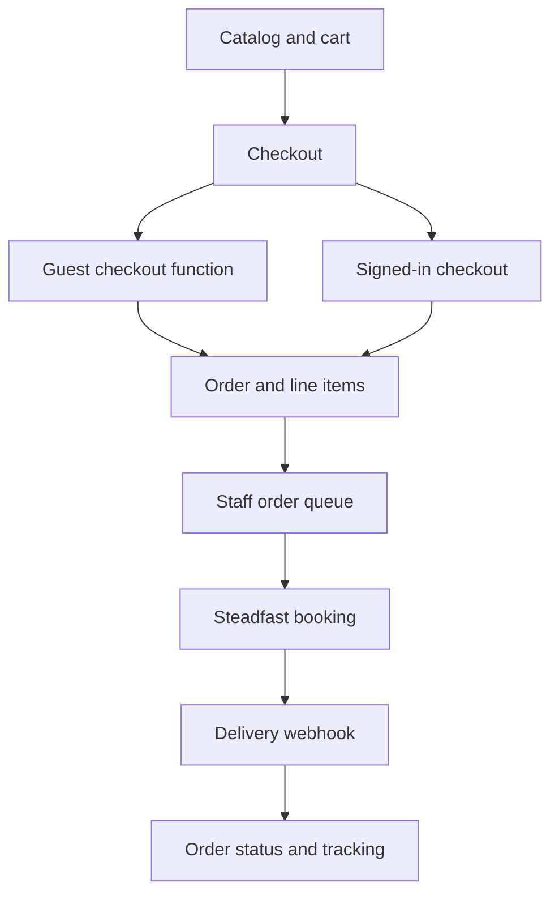

<h1 align="center">
  
</h1>

<p align="center">
  <strong>A Bangladesh footwear storefront, commerce dashboard, and multi-outlet point of sale.</strong>
</p>

<p align="center">
  <a href="https://frictionbd.com/"><strong>Visit Friction BD</strong></a> ·
  <a href="#stack-and-versions">Tech stack</a> ·
  <a href="#storefront-and-orders">Orders</a> ·
  <a href="#commerce-admin-and-pos">Admin and POS</a> ·
  <a href="#integrations-and-discovery">Integrations</a> ·
  <a href="#local-development">Local development</a> ·
  <a href="#developer">Developer</a>
</p>

## Overview

Friction BD is an online footwear store for shoppers in Bangladesh. Its React storefront handles product discovery, variant selection, checkout, and order tracking. The same application gives staff a commerce dashboard for catalog and fulfillment and a separate point of sale for outlet sales. [Storefront](./src/pages/Index.tsx) · [Admin](./src/components/admin/AdminLayout.tsx) · [Point of sale](./src/pages/admin/POS.tsx)

| Audience | What they can do |
| --- | --- |
| **Shoppers** | Browse footwear by category or brand, find a size or variant, order in BDT, and check delivery progress. |
| **Commerce and support staff** | Maintain products and stock, review orders, create manual orders, manage customers, and send shipments to the courier. |
| **Outlet staff** | Look up or scan products, ring up sales, record tender and credit, print receipts, and process returns. |
| **Administrators** | Control access, edit storefront content and promotions, configure analytics, and review sales and inventory reports. |

The animated cover combines Friction's black and red theme, its original lightning mark, and product photography from the storefront. Shahriar Nabil's orange, pink, and violet mark appears in the signature and as a watermark. The cover respects reduced-motion preferences. [Store logo](./src/assets/friction-logo-color.jpg) · [Theme tokens](./src/index.css) · [Cover source](./docs/readme/friction-bd.svg)

## Stack and versions

Package versions are resolved from [package-lock.json](./package-lock.json). The repository also ships [bun.lock](./bun.lock). PostgreSQL and Edge Function runtime versions are managed by the Supabase project.

| Technology | Locked version | Role |
| --- | --- | --- |
|  **React / React DOM** | `18.3.1` each | Storefront, admin, and POS rendering |
|  **React Router DOM** | `6.30.1` | Browser routes and lazy-loaded page boundaries |
|  **TanStack React Query** | `5.83.0` | Server-state queries, caching, and invalidation |
|  **Vite / React SWC plugin** | `5.4.19` / `3.11.0` | Dev server and production SPA build |
|  **TypeScript** | `5.8.3` | Frontend and generated database types |
|  **Tailwind CSS**  **shadcn/ui**  **Radix** | `3.4.17` / local components / per primitive below | Responsive styling and UI primitives |
|  **Lucide / Framer Motion / Embla** | `0.462.0` / `12.26.2` / `8.6.0` | Icons, transitions, and carousels |
| **React Hook Form / Zod / resolvers** | `7.61.1` / `3.25.76` / `3.10.0` | Forms and schema validation |
| **Recharts / jsPDF / AutoTable / React Barcode** | `2.15.4` / `4.0.0` / `5.0.7` / `1.6.1` | Reports, invoices, and product labels |
|  **Supabase JS** | `2.101.1` | Auth, database access, Realtime, and function calls |
|  **PostgreSQL** | Supabase-managed | Catalog, orders, stock, roles, policies, and RPCs |
|  **Supabase Edge Functions** | Supabase-managed Deno runtime | Guest checkout, email, SMS, courier, media, and conversion events |
|  **Vercel configuration** | SPA rewrite in repo | Sends browser-route requests to the app entry point |
|  **Vitest / ESLint** | `3.2.4` / `9.32.0` | Test runner and source linting |
|  **Node.js and npm**  **Bun** | Toolchains | Lockfile installs and development commands |

<details>
<summary><strong>All 76 direct dependencies and their locked versions</strong></summary>

| Package | Locked version | Scope |
| --- | --- | --- |
| `@eslint/js` | `9.32.0` | Tooling |
| `@hookform/resolvers` | `3.10.0` | Application |
| `@radix-ui/react-accordion` | `1.2.11` | Application |
| `@radix-ui/react-alert-dialog` | `1.1.14` | Application |
| `@radix-ui/react-aspect-ratio` | `1.1.7` | Application |
| `@radix-ui/react-avatar` | `1.1.10` | Application |
| `@radix-ui/react-checkbox` | `1.3.2` | Application |
| `@radix-ui/react-collapsible` | `1.1.11` | Application |
| `@radix-ui/react-context-menu` | `2.2.15` | Application |
| `@radix-ui/react-dialog` | `1.1.14` | Application |
| `@radix-ui/react-dropdown-menu` | `2.1.15` | Application |
| `@radix-ui/react-hover-card` | `1.1.14` | Application |
| `@radix-ui/react-label` | `2.1.7` | Application |
| `@radix-ui/react-menubar` | `1.1.15` | Application |
| `@radix-ui/react-navigation-menu` | `1.2.13` | Application |
| `@radix-ui/react-popover` | `1.1.14` | Application |
| `@radix-ui/react-progress` | `1.1.7` | Application |
| `@radix-ui/react-radio-group` | `1.3.7` | Application |
| `@radix-ui/react-scroll-area` | `1.2.9` | Application |
| `@radix-ui/react-select` | `2.2.5` | Application |
| `@radix-ui/react-separator` | `1.1.7` | Application |
| `@radix-ui/react-slider` | `1.3.5` | Application |
| `@radix-ui/react-slot` | `1.2.3` | Application |
| `@radix-ui/react-switch` | `1.2.5` | Application |
| `@radix-ui/react-tabs` | `1.1.12` | Application |
| `@radix-ui/react-toast` | `1.2.14` | Application |
| `@radix-ui/react-toggle` | `1.1.9` | Application |
| `@radix-ui/react-toggle-group` | `1.1.10` | Application |
| `@radix-ui/react-tooltip` | `1.2.7` | Application |
| `@supabase/supabase-js` | `2.101.1` | Application |
| `@tailwindcss/typography` | `0.5.16` | Tooling |
| `@tanstack/react-query` | `5.83.0` | Application |
| `@testing-library/jest-dom` | `6.9.1` | Tooling |
| `@testing-library/react` | `16.3.1` | Tooling |
| `@types/node` | `22.16.5` | Tooling |
| `@types/react` | `18.3.23` | Tooling |
| `@types/react-dom` | `18.3.7` | Tooling |
| `@vitejs/plugin-react-swc` | `3.11.0` | Tooling |
| `autoprefixer` | `10.4.21` | Tooling |
| `class-variance-authority` | `0.7.1` | Application |
| `clsx` | `2.1.1` | Application |
| `cmdk` | `1.1.1` | Application |
| `date-fns` | `3.6.0` | Application |
| `embla-carousel-autoplay` | `8.6.0` | Application |
| `embla-carousel-react` | `8.6.0` | Application |
| `eslint` | `9.32.0` | Tooling |
| `eslint-plugin-react-hooks` | `5.2.0` | Tooling |
| `eslint-plugin-react-refresh` | `0.4.20` | Tooling |
| `framer-motion` | `12.26.2` | Application |
| `globals` | `15.15.0` | Tooling |
| `input-otp` | `1.4.2` | Application |
| `jsdom` | `20.0.3` | Tooling |
| `jspdf` | `4.0.0` | Application |
| `jspdf-autotable` | `5.0.7` | Application |
| `lucide-react` | `0.462.0` | Application |
| `next-themes` | `0.3.0` | Application |
| `postcss` | `8.5.6` | Tooling |
| `react` | `18.3.1` | Application |
| `react-barcode` | `1.6.1` | Application |
| `react-day-picker` | `8.10.1` | Application |
| `react-dom` | `18.3.1` | Application |
| `react-easy-crop` | `5.5.7` | Application |
| `react-hook-form` | `7.61.1` | Application |
| `react-resizable-panels` | `2.1.9` | Application |
| `react-router-dom` | `6.30.1` | Application |
| `recharts` | `2.15.4` | Application |
| `sonner` | `1.7.4` | Application |
| `tailwind-merge` | `2.6.0` | Application |
| `tailwindcss` | `3.4.17` | Tooling |
| `tailwindcss-animate` | `1.0.7` | Application |
| `typescript` | `5.8.3` | Tooling |
| `typescript-eslint` | `8.38.0` | Tooling |
| `vaul` | `0.9.9` | Application |
| `vite` | `5.4.19` | Tooling |
| `vitest` | `3.2.4` | Tooling |
| `zod` | `3.25.76` | Application |

</details>

## Storefront and orders

Product pages expose category and brand paths, images, pricing, reviews, and variant availability. Shoppers can search the catalog, apply an eligible coupon, and check out with cash on delivery. Checkout uses the store's configurable shipping and minimum-order settings. [Product page](./src/pages/Product.tsx) · [Checkout](./src/pages/Checkout.tsx) · [Terms](./src/pages/TermsOfService.tsx)



1. **Create the order.** Guest checkout calls an Edge Function. Signed-in checkout uses the user's session to save the order, items, and eligible saved address. [Guest checkout](./supabase/functions/process-guest-order/index.ts) · [Signed-in flow](./src/pages/Checkout.tsx)
2. **Notify and recover.** The email function sends order updates and includes a product link for review requests. An incomplete checkout flow records eligible leads for staff follow-up. [Order email](./supabase/functions/send-order-email/index.ts) · [Lead recovery](./src/pages/admin/AbandonedCheckouts.tsx)
3. **Fulfill and track.** Staff can submit a courier booking, receive status updates, and review fulfillment history. Customers can look up order status or review their signed-in order history. [Courier dashboard](./src/pages/admin/Courier.tsx) · [Track an order](./src/pages/TrackOrder.tsx) · [Order history](./src/pages/Orders.tsx)

## Commerce admin and POS

| Workspace | Capabilities |
| --- | --- |
| **Catalog** | Products and variants, SKU import, categories and brands, prices, stock, media, and product reviews. [Catalog editor](./src/pages/admin/Products.tsx) |
| **Orders and support** | Online and manual orders, fulfillment notes, receipts, customer records and addresses, incomplete checkouts, and courier status lookup. [Orders](./src/pages/admin/Orders.tsx) · [Customers](./src/pages/admin/Customers.tsx) |
| **Website CMS** | Announcement bar, hero slider, signature section, offer banner, checkout and shipping settings, invoice settings, coupons, analytics settings, and media. [Website admin](./src/pages/admin/Website.tsx) |
| **Counter sales** | Barcode or product search, customer lookup, discounts, drafts, cash/card/mobile-banking tender records, split payments, credit, invoices, and returns. [POS](./src/pages/admin/POS.tsx) · [Sales history](./src/pages/admin/POSSalesHistory.tsx) · [Returns](./src/pages/admin/POSReturns.tsx) |
| **Outlet operations** | Outlet setup, staff access, PIN-protected actions, stock-in, outlet inventory, stock transfers, and printable barcode labels. [Management](./src/pages/admin/POSManagement.tsx) · [Stock-in](./src/pages/admin/InventoryStockIn.tsx) · [Labels](./src/pages/admin/PrintLabels.tsx) |
| **Reporting and CRM** | Basic and advanced reports, sales and expense history, credit collection, customer records, and loyalty points. [Reports](./src/pages/admin/Reports.tsx) · [CRM](./src/pages/admin/POSCRM.tsx) · [Credit payments](./src/pages/admin/POSCreditPayments.tsx) |

### Auth, data, and live updates

- **Passwordless sign-in.** The login screen supports phone OTP with Supabase Auth and Google OAuth. The callback resolves the session and returns the user to the appropriate route. [Login](./src/pages/auth/Login.tsx) · [Callback](./src/pages/auth/Callback.tsx) · [Session provider](./src/context/auth.tsx)
- **Role-based access control and RLS.** Admin and POS route guards use role, permission, and outlet context. PostgreSQL policies govern table access, while database functions handle operations such as manual order creation, inventory transfers, and outlet PIN verification. [Admin guard](./src/components/admin/ProtectedAdminRoute.tsx) · [POS guard](./src/components/pos/ProtectedPOSRoute.tsx) · [Database migrations](./supabase/migrations)
- **Realtime.** Order queues, dashboard counters, settings, and outlet inventory subscribe to relevant database changes. [Order counter](./src/hooks/useNewOrdersCount.tsx) · [Outlet inventory](./src/hooks/useOutletInventory.tsx) · [Store settings](./src/hooks/useStoreSettings.tsx)

## Integrations and discovery

| Integration | Implementation in this repository |
| --- | --- |
|  **Resend** | Order confirmation and status emails, staff notifications, and review links. [Email function](./supabase/functions/send-order-email/index.ts) |
|  **BulkSMSBD** | Supabase Send SMS Hook handler for OTP delivery through a local SMS provider. The login flow also uses an OTP rate-limit function. [SMS hook](./supabase/functions/send-sms-otp/index.ts) · [Rate limiting](./supabase/functions/check-otp-rate-limit/index.ts) |
|  **Google OAuth** | Supabase social sign-in for the customer and staff account flow. [Login route](./src/pages/auth/Login.tsx) |
|  **Cloudinary** | Product and site image uploads, media browsing and removal, and transformed image URLs for the storefront. [Media functions](./supabase/functions/cloudinary-media/index.ts) · [Image helpers](./src/lib/cloudinary.ts) |
| **Steadfast Courier** | Consignment booking, courier status lookups, dashboard KPIs, and delivery-status webhook handling with event records. [Booking](./supabase/functions/send-to-steadfast/index.ts) · [API](./supabase/functions/steadfast-api/index.ts) · [Webhook](./supabase/functions/steadfast-webhook/index.ts) |
| **BD Courier** | Courier delivery-history lookup and cache warming for staff order review. [Status lookup](./supabase/functions/check-fraud-status/index.ts) · [Cache warming](./supabase/functions/warm-fraud-cache/index.ts) |
|  **Meta Pixel and Conversions API** | Browser events and a server-side CAPI function share an event ID for event deduplication. [Analytics client](./src/services/Analytics.ts) · [CAPI function](./supabase/functions/capi-event/index.ts) |
|  **GA4**  **Google Tag Manager** | Configurable browser tracking, route views, and commerce events for product views, cart, checkout, and purchase. [Analytics client](./src/services/Analytics.ts) · [Tracking settings](./src/components/admin/AnalyticsTrackingTab.tsx) |
|  **Cloudflare Turnstile** | The repository includes the browser script and a reusable widget. [HTML entry](./index.html) · [Widget](./src/components/auth/TurnstileWidget.tsx) |
|  **SEO and JSON-LD** | Product structured data with offers and ratings where available, product and brand canonicals, social preview metadata, favicon and manifest assets, and crawl entry points. [Product metadata](./src/pages/Product.tsx) · [Brand metadata](./src/pages/Brand.tsx) · [Sitemap](./public/sitemap.xml) · [Robots](./public/robots.txt) |

Integration settings and provider credentials are configured per environment. The frontend uses the Supabase publishable key, and the function code reads server credentials from the runtime environment or restricted settings.

## Local development

Use the repository's lockfile to install packages. Vite serves the app at `http://localhost:8080`. [Vite config](./vite.config.ts)

```bash
git clone https://github.com/ShahNabil1/Friction-BD.git
cd Friction-BD
npm ci
npm run dev
```

For Bun, use `bun install --frozen-lockfile` and `bun run dev`. Use `npm test` for Vitest, `npm run lint` for ESLint, and `npm run build` to generate the `dist/` output.

For an isolated backend, configure the [Supabase client](./src/integrations/supabase/client.ts) and [project settings](./supabase/config.toml) for your development project. Apply the SQL migrations and configure the functions, providers, and OAuth redirect URLs needed for the workflows you want to test. Keep service-role and provider credentials in the function environment or restricted settings.

| Location | What it contains |
| --- | --- |
| [src/App.tsx](./src/App.tsx) | Storefront, account, admin, and POS routes |
| [src/pages](./src/pages) | Storefront pages and commerce workspaces |
| [src/components/pos](./src/components/pos) | Counter checkout, receipts, customer selection, and outlet operations |
| [src/hooks](./src/hooks) | Query hooks, session roles, subscriptions, and inventory state |
| [supabase/migrations](./supabase/migrations) | SQL schema, permissions, RLS policies, triggers, and database functions |
| [supabase/functions](./supabase/functions) | Edge Functions for checkout, tracking, notifications, courier, media, and conversion events |
| [public](./public) | Storefront icons, social preview, manifest, sitemap, and robots |

## Developer

<p>
  <a href="https://shahnabil.com/"></a>
</p>

**Shahriar Nabil**

[Website](https://shahnabil.com/) · [hello@shahnabil.com](mailto:hello@shahnabil.com) · [Phone +8801790736863](tel:+8801790736863) ·  [WhatsApp](https://wa.me/8801790736863) · [GitHub](https://github.com/ShahNabil1)
